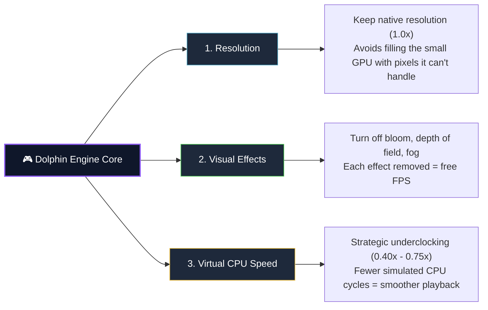
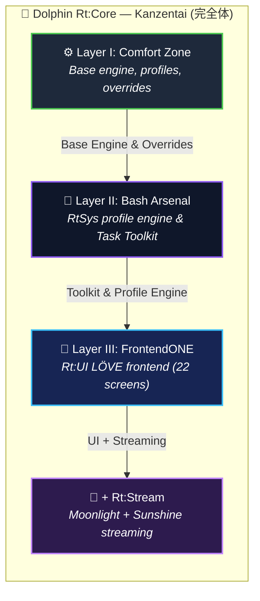

<div align="center">
  <h1> Dolphin Rt:Core for muOS </h1>
  <h3><b><i>Kanzentai (完全体) — One Entity. All Layers Docked. Sbrobs.</i></b></h3>
  <p><b>Surgically tuned GameCube &amp; Wii emulation for the Allwinner H700 chipset under muOS.</b></p>

  <p>
    <a href="https://github.com/SilverCrow2323/dolphin-rt-core/releases/latest">
      
    </a>
    
    
    
    
  </p>

  <p>
    <b>Codename:</b> <code>Andromeda</code> · <b>muOS release:</b> <code>Sloppy Kofi (2606.0)</code> · <b>Form:</b> <code>Kanzentai (完全体)</code>
  </p>
</div>

---

> ### ⚡ **TL;DR — Straight to the Point**
> ***Stock firmware gives you emulation and calls it a day. muOS tears the door off the hinges. Dolphin Rt:Core is what happens next.***
>
> Running GameCube and Wii games on an **Allwinner H700** handheld is not a "plug-and-play" situation. It is (unfortunately) a careful, engineering and stressful-heavy job. It means working within a (REALLY) strict $1\text{ GB}$ RAM budget, cutting as much unnecessary graphical effects as possible, and pushing titles to run at a stable $50\text{--}60\text{ FPS}$ even though they were never (and ever) meant to run on this chip.
>
> This repository is **that challenge, solved...kinda.** Starting with v12.0.0 **"Kanzentai" (完全体)**, the three old flavours (Comfort Zone, Bash Arsenal, FrontendONE) are no longer separate releases: they have been docked into **one single package**. One installer, one install, one entity. No intricate situations or layered installs (as we already did with 11.5.01).
>
> 🏛️ *Whant to know something more on how this port began? Read the full **[Digital Fossil Record & Core History Archive (Core_History/README.md)](Core_History/README.md)**.*

---

## 🧠 <u>The Harsh Hardware Reality & What We Can Do</u>

Before using any profile, it helps to understand **what the hardware can, cannot and never in life can do**. The H700 is a small, low-power chip, and emulating a GameCube or a Wii on it is...genuinely not the best idea you may come up with. But hey, who cares? Let's try to do it anyway! It's a pleasure when you make it on rising the avg FPS from 18 to 20 right?....Right?!
Back on track, here's the disgraceful and challenging situation we're in (with both boots):

| Component | What it is | What it means for you |
| :--- | :--- | :--- |
| **SoC (CPU)** | Allwinner H700 — 4 cores at 1.5 GHz | **The CPU** has to "translate" every GameCube/Wii instruction into something it can run. This translation is heavy, and four small cores are not much. And apparently the engaged translator was not the best of his class. |
| **GPU** | Mali-G31 MP2 | **The graphics chip** is, and I'm sure you'll be surprised, SMALL and shares memory bandwidth with everything else. Complex scenes, heavy effects, and high resolutions will slow it down quickly like hitting both your legs with a bat. |
| **RAM** | 1 GB LPDDR4, shared between CPU and GPU | **Memory** is tight. Everything lives in the same 1 GB pool — the system, the GPU textures, the emulator, like my grand-grand-grandfathers sleeping together in a drawer. No room (or drawers) for waste. |
| **Display** | 640×480 up to 720×720, depending on model | **The screen** is (imagine what) small. Rendering at native resolution ($1.0\times$) is the only reasonable choice, anything higher just wastes power. But actually neither that choice is reasonable. Neither this project.  |
| **Storage** | MicroSD card | **The card** is slower than a hard drive, we like to play in the toughtest situaions. We're real squared men here, afraid uh? (Using the compressed **RVZ** format may help with loading times...but don't expect any miracles at all) |

To get past the hardware's natural limits, **Dolphin Rt:Core** goes into the battlefield on **three main leyers + 1**:



### ⚠️ <u>What to Realistically Expect</u>

Even with everything tuned, the physical limits of this chip do not change, for this you need 7 spheres called Dragon Balls. Here is roughly how games will perform:

- 🟢 **Light 2D & 3D games** — $30 \text{ -- } 50\text{ FPS}$ *(Fully playable, comfortable)*
- 🟡 **Medium 3D games** — $15 \text{ -- } 25\text{ FPS}$ *(If you're lucky, playable with some speed hacks and blasphemy)*
- 🔴 **Heavy 3D games** — $5 \text{ -- } 15\text{ FPS}$ *(Stunningly Perfect and smooth. If the game is one single screen. Otherwise...In your Dreams. )*

> [!IMPORTANT]
> **Why not just overclock that bitch?** Calm down, Johnny. Don't xongle the bongle so quicly. Overclocking the real hardware makes it hotter and drains the battery, plus it does **not** fix the real problem, which is that the emulated GameCube/Wii CPU is running like a roadrunner for the emulator (the coyote) to keep up. The right move is the opposite: *underclock the emulated CPU* (pretend it's slower, like a sloppy kofi). This reduces the workload without any physical abuse on the device.

---

## ⚙️ <u>Base Configuration — What Gets Tuned, and Why</u>

Every part of Dolphin Rt:Core shares a base configuration tuned specifically for this chip and this OS. And like this chip and this OS are the results. Here are the main settings, with plain-English explanations of **what they try to do**, basically our little hired goons from the streets.

### 🧩 `Dolphin.ini` — Core Engine Settings

| Setting | Value | What it means |
| :--- | :---: | :--- |
| `CPUCore` | `4` | Uses **JITARM64**, the fastest way to "translate" GameCube/Wii CPU code on this device. Huge speed boost compared to the slow interpreter. Is the most skilled translator in your roster for this job. |
| `CPUThread` | `True` | Runs the emulated CPU on its own thread, so the graphics work doesn't block it. |
| `EnableIdleSkipping` | `True` | Skips the moments where the emulated CPU would just be beating around the bush. Free performance for ya, boy. |
| `SyncGPU` | `False` / `True` | **Off** for speed. **On** only when a game glitches and whines loudly, so we force the graphics to stay in sync and shut up. Like the best sloppy gatekeepers in the west. |
| `Overclock` | `0.40` – `1.00` | **Underclocks** the *emulated* CPU (not the real one Johnny, sit down). Lower value = smoother frame rate, but risks games running in slow motion, so xongle it carefully. |
| `TimingVariance` | `40` – `60` | Gives the audio system a bit of "slack". Higher value = fewer crackles and pops. Same gatekeepers story. |
| `FastDiscSpeed` | `True` | Pretends the disc drive is faster than real hardware, like in its delusional fantasies... Faster loading. Let's keep him in its dream worlds. |
| `Framelimit` | `1` | Auto-caps the emulator to $50\text{ Hz}$ (PAL) or $60\text{ Hz}$ (NTSC), matching the game's native frame rate. |
| `SkipIPL` | `True` | Skips the GameCube boot animation and jumps straight into the game. Less homeworks for Johnnys |

### 🎨 `GFX.ini` — Graphics & Rendering

| Setting | Value | What it means |
| :--- | :---: | :--- |
| `Backend` | `OGL` | Vulkan on Panfrost is EXPERIMENTAL and NON-CONFORMANT. Use OGL. Always. This is not a suggestion. This is physics. |
| `InternalResolution` | `1` | **Native resolution only** ($1.0\times$). The small Mali GPU cannot afford to render more pixels. |
| `ShaderCompilationMode` | `3` | Uses "skip drawing" during shader compilation. Instead of pausing to compile, the emulator briefly skips unfinished objects. Slight pop-in, but no stutter. |
| `DisableFog` | `True` / `False` | Removes fog effects where possible. Free performance, minor visual change. |
| `FastDepthResult` | `True` | Faster depth (Z-buffer) handling. |
| `EFBToTextureEnable` | `True` | Keeps frame-buffer copies inside the GPU's memory, not in system RAM. Big win. |
| `SkipEFBCopyToRam` | `True` | Skips an extra copy step that is slow on this hardware. |
| `DeferEFBCopies` | `True` | Batches several frame updates together so the GPU works less. |
| `XFBToTextureEnable` | `True` | Same idea as EFB, but for the final output frame. |
| `FastTextureSampling` | `True` | Uses a cheaper texture filtering path. |
| `SafeTextureCacheColorSamples` | `0` | Turns off the "safety check" on textures. Maximum speed; only change this if a specific game glitches. |
| `EnableGraphicsMods` | `True` | Lets the emulator load custom graphical fixes and texture packs at runtime. |

---

## 🔱 <u>The Unified Entity — All Layers Docked (Kanzentai)</u>

> [!NOTE]
> **What does "Kanzentai" mean?** In Japanese tokusatsu shows (Kamen Rider, Super Sentai, Ultraman), *Kanzentai* (完全体) is the **"perfect form"**: the final shape a hero takes after all separate modules have **docked** together. That is exactly what happened here. The three old flavours — which used to be three separate releases — are now docked into **one package**, one installer, one body.

Starting with v12.0.0 **Andromeda "Kanzentai"**, everything lives in **one `.muxupd` file**. The **Env Triage** screen (Settings ▸ About & Tools) checks every layer and tells you whether it is **HEALTHY**, **DEGRADED**, or **BROKEN**.



### ⚙️ Layer I — Comfort Zone *(Base Engine)*

**What it is:** the foundation of the whole project. This is where you find the emulator binary, the base configuration, the per-game settings, the texture packs, the graphical mods, and the launcher script that muOS calls when you press "play".

**What it does:**
- Ships **7 pre-tuned profiles** — `performance`, `compatibility`, `rintromping`, `speedhacks`, `blackscreenfix`, `sweetspot`, and `default` — each tuned for a different type of game.
- Removes post-processing bloom globally (the fuzzy glow many games use). This alone gives a small but noticeable speed boost.
- Includes a **Crash Nitro Kart HD texture pack** that fixes the well-known texture tiling problems on that game's HUD.
- Provides **12+ per-game overrides** in `GameSettings/` that fix specific titles without you having to touch anything.
- Supports the native **START + SELECT** shutdown hotkey: the emulator closes cleanly, and memory card saves are safe.

**What it does NOT do:** it does not change how the emulator is tuned beyond its built-in profiles. That is what Layer II is for.

---

### 🔧 Layer II — Bash Arsenal *(Power-User Control)*

**What it is:** a toolkit that sits on top of Comfort Zone and gives you on-device control. It uses muOS's own **Task Toolkit** system — the same menu you already use for other system tasks.

**What it does:**
- Extends the profiles with three **execution tiers**:
  - **`Lite`** — almost no hacks, best visual quality.
  - **`Std`** — balanced, recommended for most cases.
  - **`Max`** — aggressive speed hacks, best for struggling games.
- Adds **over 30 automation scripts**, grouped into 7 categories:
  1. Adjusting profiles
  2. Toggling effects (bloom, depth of field, fog, audio)
  3. Managing configuration files
  4. Scanning for new graphic mods automatically
  5. Diagnostics and log viewing
  6. An on-device technical manual
  7. Save data tools
- Builds **dynamic toggle menus** for whatever you have in the `GraphicMods/`, `Textures/`, and `Riivolution/` folders. Put a mod in the folder, and it appears in the menu.
- Lets you choose between **Clean** core assignment (the default) or **Tier-exposed** assignment (each folder can pick its own tier).

**What it does NOT do:** it does not require any terminal or configuration file editing. Everything is menu-driven.

---

### 🎨 Layer III — FrontendONE *(Full Graphical App)*

**What it is:** a real, graphical frontend — the **Rt:UI** (v3.6.0 "Kanzentai") — running on **LÖVE 2D**. It turns the handheld into a mini-console.

**What it does:**
- Gives you a **media library** with box art, filters, search, and one-button launch for GameCube and Wii titles.
- Rotates between the **GameCube dashboard** and the **Wii dashboard** using <kbd>SELECT</kbd>, changing the whole look and feel.
- Includes a **Workshop** where you can create, test, and apply custom profiles, graphic mods, and controller mappings — no command-line involved.
- Shows a **live compatibility guide** with what other users have tested: FPS, settings, profile used.
- Runs a **Triage screen** (Settings ▸ About & Tools) that tells you if all layers are correctly installed.
- Boots through a guided pipeline: check for updates → download data files → scan ROMs → apply bundled settings → download cheats → build game cards.

**What it does NOT do:** it does not replace Layers I and II. It uses them underneath.

---

### 📡 Rt:Stream *(Streaming from Your PC)*

**What it is:** a new feature in v12.0.0. It lets you play GameCube and Wii games that are hosted on your PC, streamed to the handheld over your local network using **Sunshine** (on the PC) and **Moonlight** (on the device).

**What it does:**
- Adds a **Stream** section directly inside Rt:UI, so you don't need a separate app.
- Offers three views (Flow, Grid, List), favourites, recent history, and cover art syncing from your PC.
- Handles **Wake-on-LAN** (turn your PC on from the handheld), latency tests, and diagnostics.
- Uses the same library folder structure as local games, so it feels natural.

**What it does NOT do:** it does not require you to do anything on the handheld other than enter your PC's address. Everything else is set up on the PC side.

---

### 🐬 The Dolphin Binary

> [!IMPORTANT]
> **What is the Dolphin binary?** It is the actual emulator program — the software that reads GameCube/Wii discs and runs them. Everything else in this project (profiles, UI, scripts) exists to *configure and launch* this binary.
>
> **Where it lives:** `/opt/muos/share/emulator/dolphin/dolphin`
>
> **It is now included in the package.** If you are building from source, make sure the `dolphin` executable is placed in exactly that path before installing Rt:Core.

---

## 💡 <u>Practical Tips & Format Standards</u>

### 📺 1. Prefer PAL Games ($50\text{ Hz}$) When Available

**What this means:** PAL (European) games run at **50 FPS**; NTSC (American/Japanese) games run at **60 FPS**. PAL games do the same amount of work per second **17% fewer times**, so they are noticeably easier for the chip to handle.

$$\text{Workload reduction} = \frac{60 - 50}{60} \approx 16.67\%$$

**Practical rule:** if a game has both a PAL and an NTSC release, **prefer the PAL version** on the H700. Many titles that stutter on NTSC run smoothly on PAL.

---

### 📦 2. Convert ISOs to RVZ Format

**What this is:** `.iso` and `.gcm` are uncompressed disc images. They waste space and read slowly from an SD card. **RVZ** is Dolphin's own compressed format: smaller, faster to load, and it works with every game.

**How to convert one game:**
```bash
dolphin-tool convert -i "input_game.iso" -o "output_game.rvz" -f rvz -b 131072 -c zstd -l 5
```

**What each flag does:**

| Flag | Value | Meaning |
| :---: | :---: | :--- |
| `-f` | `rvz` | Output format — Dolphin's native compressed container. |
| `-b` | `131072` | Block size in bytes ($128\text{ KiB}$). Matches the way the chip reads memory efficiently. |
| `-c` | `zstd` | Compression algorithm — **Zstandard**, fast to decompress. |
| `-l` | `5` | Compression level. **Level 5 is the sweet spot** for this hardware. |

> [!WARNING]
> **Do not use level 9 or LZMA compression.** They make the files smaller, but the handheld CPU then has to work harder every time it reads a game asset, causing stutters. Level 5 is the right balance.

---

### 🎯 3. Per-Game Overrides (`GameSettings`)

**What this is:** if a single game needs a tweak (extra underclock, a specific texture cache value), you don't change the global profile — you create a **per-game file** that only affects that title.

**Where it goes:** `/share/emulator/dolphin/GameSettings/<GAMEID>.ini`

**Example** — `GMSP01.ini` (*Super Mario Sunshine*):
```ini
[Core]
Overclock = 0.600000
OverclockEnable = True

[GFX]
EFBAccessEnable = True
SafeTextureCacheColorSamples = 512
```

**Explanation of each line:**
- `Overclock = 0.600000` — pretend the GameCube CPU is running at 60% speed. Saves a lot of work.
- `OverclockEnable = True` — actually apply that setting.
- `EFBAccessEnable = True` — turns on a compatibility feature that fixes certain graphics glitches.
- `SafeTextureCacheColorSamples = 512` — uses a more accurate (but slightly slower) texture cache, which fixes certain textures in this game.

---

## 📂 <u>Where Files Live on the Device</u>

Here is the folder layout, with a one-line explanation of each part.

```text
/opt/
└── muos/
    ├── script/
    │   └── launch/
    │       └── ext-dolphinrt.sh            # 🚀 Called by muOS when you launch a game
    └── share/
        ├── emulator/
        │   └── dolphin/
        │       ├── dolphin                 # 🐬 The actual emulator program
        │       ├── Config/                 # ⚙️ The active .ini settings used right now
        │       │   ├── Dolphin.ini
        │       │   ├── GFX.ini
        │       │   ├── GCPadNew.ini
        │       │   └── WiimoteNew.ini
        │       ├── GameSettings/           # 🎯 Per-game overrides (one file per game)
        │       ├── Load/
        │       │   ├── GraphicMods/        # 🎨 Bloom removal, DOF fixes, etc.
        │       │   └── Textures/           # 🖼️ HD texture packs (e.g. Crash Nitro Kart)
        │       ├── RtSys/                  # 🛠️ System scripts (exit watcher, uninstaller, logs)
        │       │   ├── overlay_exit.sh
        │       │   ├── uninstall_dolphinrt.sh
        │       │   └── logs/               # 📝 Capped diagnostic log files
        │       ├── Sys/                    # 🧬 System resources: fonts, shaders, game list
        │       │   └── GC/                 # GameCube IPL and region fonts
        │       └── Wii/                    # 🎮 Simulated Wii internal memory (NAND)
        └── info/
            └── manifest/                   # 🧩 The core list (Andromeda manifest)
                └── core.json               # or split core/<Namespace>/<System>.json
```

**Short version of what each top folder does:**
- **`ext-dolphinrt.sh`** — the launcher: it prepares the environment and starts Dolphin.
- **`Config/`** — the settings currently in use.
- **`GameSettings/`** — per-game exceptions.
- **`Load/`** — optional add-ons (texture packs, graphic mods).
- **`RtSys/`** — the toolkit scripts and logs.
- **`Sys/`** — Dolphin's built-in data.
- **`Wii/`** — the simulated Wii filesystem.
- **`info/manifest/`** — where Andromeda keeps the list of emulators per system.

---

## 📊 <u>Compatibility Database</u>

**What it is:** an online database, kept up to date, that tells you **how well each game runs** on this hardware — with FPS numbers, recommended profiles, and user notes.

It currently covers over **200 GameCube and Wii titles**.

🌐 **[Open the Compatibility Matrix](https://silvercrow2323.github.io/Dolphin-Core-for-MuOS/)**

**How to contribute:** if you have tested a game that isn't in the list, open a report using the community template:

🐞 **[Submit a Test Report](https://github.com/SilverCrow2323/dolphin-rt-core/issues/new?template=dolphin-rt-core-test-report.yml)**

---

## 🙏 <u>Credits, History & Community</u>

<div align="center">
  
  <br>
  <b>sirpips aka SilverCrow2323</b>
  <br>
  <i>SPDW Factory Lab — Lead Maintainer</i>
</div>

<br>

> [!NOTE]
> **Project Heritage & The Ethos of *Chou Henka* (超変化):**
>
> Running GameCube and Wii emulation on the Allwinner H700 is widely considered a bad idea. The chip is small, the RAM is limited, and the GPU is not designed for this kind of workload. The Dolphin port on muOS was originally **started, kept alive, and slowly improved by early community pioneers** — people who laid the foundational code, the launcher hooks, and the very first core binaries.
>
> The project was later adopted by **SPDW Factory (sirpips aka SilverCrow2323)** with one goal: ***Chou Henka* (超変化)** — a radical transformation that pushes the emulator and the hardware to their absolute limit. The aim is not "just make it boot" but "make it playable".
>
> With **v12.0.0 Andromeda "Kanzentai"**, that evolution reached its **perfect form**: all layers docked together, one package, one entity.
>
> 🏛️ **For the full timeline, original forum posts, and legacy builds, see [Core_History/README.md](Core_History/README.md).**

### 🐬 Core Development & Pioneer Lineage

| Contributor | Role & Contribution |
| :--- | :--- |
| **@Speedrun** ([Speedrun [+.[🐬].%]](https://community.muos.dev/u/speedrun)) | **Lead Core Pioneer.** Author of the original standalone Dolphin port on muOS, initial JIT tweaks, and the V9 universal core architecture. |
| **@FireBattleInMtl** ([@FireBattleInMtl](https://community.muos.dev/u/firebattleinmtl)) | **Shell Automation.** Built the auto-injecting `launch.sh` pipeline and solved early Linux execution permissions. |
| **@Snow** (SnowV8) | **Systems Compiler.** Compiled Dolphin ARM64 binaries from source and stabilized early frame times. |
| **@bitter_bizarro** | **System Maintainer.** Updated assignment structures and scripts for muOS Goose compatibility. |
| **@Magnaderra** | **Community Historian.** Preserved early release threads and compatibility lists on the MustardOS forums. |
| **Testing & Verification Team** | **@razorbeamz**, **@arkun**, **@SkiffguardLando**, **@chronoss0109**, **@Kirky**, **@Mikethe3ird**, **@Symphonial**, **@giodude**, **@lasagnesetting**, **@joshuarcastillo** |

---

## 🔗 <u>Links & Resources</u>

- 🏛️ **[Dolphin Core History & Archive](Core_History/README.md)** — original forum threads and legacy builds
- 🌐 **[GitHub Repository](https://github.com/SilverCrow2323/dolphin-rt-core)**
- 📦 **[Latest Releases](https://github.com/SilverCrow2323/dolphin-rt-core/releases/latest)**
- 📊 **[Compatibility Database](https://silvercrow2323.github.io/Dolphin-Core-for-MuOS/)**
- 💾 **[Official muOS Documentation](https://muos.dev)**
- 🐬 **[Dolphin Emulator Project](https://dolphin-emu.org)**

---

<div align="center">
  
  
  <br><br>
  <b>Dolphin Rt:Core for muOS — Kanzentai (完全体)</b><br>
  <b>Andromeda · Sloppy Kofi (2606.0)</b><br>
  <b><u>Still Sbrobbing. Always Rintromping.</u></b> 🎮
</div>
