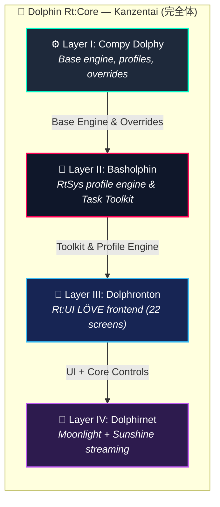

<div align="center">
 <h1> Dolphin Rt:Core for muOS </h1>
  <h3><b><i>Kanzentai (完全体) — One Entity. All Layers Docked. Sbrobs.</i></b></h3>
  <p><b>Surgically tuned GameCube &amp; Wii emulation for the Allwinner H700 chipset under muOS.</b></p>
  <p>
    <a href="https://github.com/SilverCrow2323/dolphin-rt-core/releases/latest">
      
    </a>
    
    
    
    
    
    
    
  </p>
  <p>
    <b>Codename:</b> <code>Sloppy Kofi</code> · <b>muOS release:</b> <code>Andromeda (2606.0)</code> · <b>Form:</b> <code>Kanzentai (完全体)</code>
  </p>
</div>


---


> ⚡ Stock firmware gives you emulation and calls it a day. muOS timidly opens the door. Dolphin Rt:Core is what slams the door wide open to see what's beyond the line drawn by the fearful. Fuck you and your ethos, let's go Amigos!***
>
> Running GameCube and Wii games on an **Allwinner H700** handheld is not a "plug-and-play" situation. It is (unfortunately) a careful, engineering-heavy, and stressful dirty job.
> A dirty job that someone has todo.
Actually no, it's not true. But I was dreaming to say that somewhere one day.
> It means working within a (REALLY) strict $1\text{ GB}$ RAM budget, cutting as many unnecessary graphical effects as possible, and pushing titles to run at a stable $50\text{--}60\text{ FPS}$ even though they were never (ever) meant to run on this chip.
>
> This repository is **that challenge, solved... kinda.** Starting with v12.0.0 **"Kanzentai" (完全体)**, the three old flavours (Comfort Zone, Bash Arsenal, FrontendONE) are no longer separate releases: they have been docked together into **one single <u>Franken package</u>**. One installer, one install, one entity. No intricate situations or layered installs (as we previously did with 11.5.01).
>
> 🏛️ *Want to know more about how this port began? Read the full [**Digital Fossil Record & Core History Archive (Core_History/README.md)**](Core_History/README.md).*

## 🧭 Platforms & Releases

One project, several firmwares. Dolphin's own configuration (`Dolphin.ini`, `GFX.ini`, `GameSettings/`, graphic mods,
texture packs, controller profiles) is plain Dolphin data and is shared by every build; what changes per platform is the
**launcher glue, the core registration and the packaging**.

| Platform | Status | Package | What it means |
| :--- | :--- | :--- | :--- |
| **muOS 2606.0 Andromeda** (*Sloppy Kofi*) | ✅ **v12.0.0 — current** | `Dolphin_RtCore_v12_0_0_Andromeda.muxupd` | Everything in this README. Registers itself in the Andromeda core manifest, signed-manifest install, Rt:Stream built in. |
| **muOS 2601.1 Funky Jacaranda** | 🟡 **Legacy line** — v11.5.1 "Triptych" | `Dolphin_RtCore_v11_5_1_Triptych_Bundle.muxupd` | Uses the old `info/assign/*.ini` registry. Stays available; a v12 backport is **planned**, not built. |
| **Knulli** (Batocera-based) | ✅ **Rt:Core K 0.2.0** — [`dolphin-rtcore-k/`](dolphin-rtcore-k) | `get.sh` / `install.sh` | EmulationStation integration (systems `wii` + `gamecube`, profiles as per-game cores, per-game options, safe exit). Tested by the maintainer on an RG35XX-H, Knulli Scarab 2026/05/11. Bring your own `core/dolphin`. |
| **ROCKNIX** | 🟠 **Experimental** — [`dolphin-rtcore-r/`](dolphin-rtcore-r) | `install.sh` | A derivative of Rt:Core K adapted from the ROCKNIX sources (paths, ES custom systems, `system.cfg`). Passes dry-run tests on a fake filesystem; **never run on a device**. Per-game option menu is not available (see its README). |

> [!NOTE]
> "Experimental" means it exists and passes automated dry-run tests but has not been run on hardware. This table only lists
> a release as available when it was tested on that firmware.
>
> **No firmware ships Dolphin for the H700.** Knulli builds it only for x86_64, Raspberry Pi 5 and SM8250; ROCKNIX's H700
> image has no Dolphin at all. Every H700 build therefore needs *your own* aarch64 `dolphin` binary.

## 🗂️ Repository layout

One repository, one folder per deliverable:

| Folder | What it is |
| :--- | :--- |
| [`dolphin-rtcore-muos/`](dolphin-rtcore-muos) | **muOS Andromeda** build: shared app + emulator tree, muOS-only overlay, `tools/build-muxupd.sh`, `tools/verify-muxupd.sh` |
| [`dolphin-rtcore-k/`](dolphin-rtcore-k) | **Knulli** port (Rt:Core K) |
| [`dolphin-rtcore-r/`](dolphin-rtcore-r) | **ROCKNIX** port (experimental) |
| [`portal/`](portal) | **PC side**: Rt:Stream Portal, wire protocol (`portal/docs/PROTOCOL.md`), packaging for deb / rpm / Arch / AppImage |
| `Core_History/` | Earlier releases (v11.5.00 "Triptych" and older, the Jacaranda line) |
| `data/`, `assets/`, `docs/` | Compatibility database, artwork, documentation |

Build everything from source: `dolphin-rtcore-muos/tools/build-muxupd.sh`, `portal/tools/build-packages.sh all`;
test the Knulli/ROCKNIX ports with `tests/test_ports_dryrun.sh`;
build ready-to-install port archives (shared `core/` + **your** aarch64 `dolphin`) with `tools/make-port-release.sh k|r --binary /path/to/dolphin`.

## 📚 Documentation & developer tools

- **[Engineering guide](docs/REPO_GUIDE.md)** — repository map, development, quality and release workflow.
- **[Frontend documentation index](docs/README.md)** — UI architecture, screens, paths, profiles and testing.
- **[GitHub Wiki source](wiki/Home.md)** — concise user/developer pages; publish with `tools/publish-wiki.sh`.
- **UI screenshots:** `tools/capture-ui.sh --screens "boot,library,settings,triage"`.
- **Visual asset audit:** `python3 tools/asset_inventory.py --contact-sheet` (Pillow optional).

The screenshot helper uses the frontend's existing opt-in `core/devshot.lua` hook; it does not modify application source. Generated reports and captures stay under `artifacts/`.

---
 
## 📥 Install (muOS Andromeda)

1. Copy `Dolphin_RtCore_v12_0_0_Andromeda.muxupd` into the **`ARCHIVE`** folder of the ROM card and install it from **Archive Manager**.
   The package carries the integrity manifest (`manifest.sha256`) that Andromeda requires, and registers
   **Nintendo Gamecube** and **Nintendo Wii** in the core list by itself when the installation ends.
2. Make sure the `dolphin` binary sits at `/opt/muos/share/emulator/dolphin/dolphin`.
3. Open **Dolphin Rt:Core** from *Applications*. If GameCube/Wii are not listed as systems, run
   *Task Toolkit ▸ Dolphin Rt-Core ▸ Register GameCube and Wii* (the app also checks this at every start).
4. In Content Explorer pick the GameCube/Wii folder ▸ **Core Assignment** ▸ choose a Dolphin profile.

Switching between **Mode 1 (standard profiles only)** and **Mode 2 (all lite/std/max tiers)** is a Task too
(*Profiles - Standard Only* / *Profiles - All Tiers*).

> [!WARNING]
> On 2606.0 the core manifest is **one file** (`MUOS/info/manifest/core.json`) that *replaces* the bundled one. Rt:Core merges its
> two systems into it without touching any other system and keeps a one-time backup (`core.json.rtcore.bak`), but a muOS update
> that adds new systems will not show them until the manifest is re-merged.

## 🧠 The Harsh Hardware Reality & What We Can Do

Before using any profile, it helps to understand **what the hardware can, cannot, and will never do**. 
The H700 is a small, low-power chip, and emulating a GameCube or a Wii on it is... genuinely not the best idea you may come up with. But hey, who cares? Let's try to do it anyway! It's a pleasure when you manage to raise the avg FPS from 18 to 20, right?... Right?!
Back on track, here is the disgraceful and challenging situation we're in (with both boots):

| Component | What it is | What it means for you | 
| ----- | ----- | ----- | 
| **SoC (CPU)** | Allwinner H700 — 4 cores at $1.5\text{ GHz}$ | **The CPU** has to "translate" every GameCube/Wii instruction into something it can run. This translation is heavy, and four small cores are not much. And apparently the engaged translator was not the best of his class. | 
| **GPU** | Mali-G31 MP2 | **The graphics chip** is, and I'm sure you'll be surprised, SMALL and shares memory bandwidth with everything else. Complex scenes, heavy effects, and high resolutions will slow it down quickly like hitting both your legs with a bat. | 
| **RAM** | $1\text{ GB}$ LPDDR4, shared between CPU and GPU | **Memory** is tight. Everything lives in the same $1\text{ GB}$ pool — the system, the GPU textures, the emulator, like my grand-grand-grandfathers sleeping together in a drawer. No room (or drawers) for waste. | 
| **Display** | $640\times 480$ up to $720\times 720$, depending on model | **The screen** is (imagine what) small. Rendering at native resolution ($1.0\times$) is the only reasonable choice; anything higher just wastes power. But actually, neither that choice is reasonable. Neither this project. | 
| **Storage** | MicroSD card | **The card** is slower than a solid-state drive, but we like to play in the toughest situations. We're real squared men here, afraid uh? (Using the compressed **RVZ** format may help with loading times... but don't expect any miracles at all) | 

### ⚠️ What to Realistically Expect

Even with everything tuned, the physical limits of this chip do not change, for this you need 7 spheres called Dragon Balls. Here is roughly how games will perform:

* 🟢 **Light 2D & 3D games** — $30 \text{ -- } 50\text{ FPS}$ *(Fully playable, comfortable)*

* 🟡 **Medium 3D games** — $15 \text{ -- } 25\text{ FPS}$ *(If you're lucky, playable with some speed hacks and blasphemy)*

* 🔴 **Heavy 3D games** — $5 \text{ -- } 15\text{ FPS}$ *(Stunningly perfect and smooth. If the game is one single screen. Otherwise... In your Dreams.)*

> [!IMPORTANT]
> **Why not just overclock that bitch?** Calm down, Johnny. Don't xongle the bongle so quickly. Overclocking the real hardware makes it hotter and drains the battery, plus it does **not** fix the real problem, which is that the emulated GameCube/Wii CPU is running like a roadrunner for the emulator (the coyote) to keep up. The right move is the opposite: *underclock the emulated CPU* (pretend it's slower, like a sloppy kofi). This reduces the workload without any physical abuse on the device.

---

## 🛠️ OS-Level & Hardware Tweaks (muOS + System)

To extract every last frame safely on the Allwinner H700 under muOS, configure these system-level parameters based on community research and Linux kernel patches:

### 1. CPU Governor Management: `performance` vs. `interactive`
The H700 can experience instability or sudden frame drops under dynamic governors (like `ondemand` or `schedutil`).
* **[Performance Governor (Recommended for Dolphin):](https://patchew.org/linux/20241128154556.2743839-1-simons.philippe@gmail.com/#1)** Locks CPU cores at $1.5\text{ GHz}$. Delivers maximum stability and consistent frame pacing.
* **Interactive Governor (Thermal/Battery Compromise):** Reduces audio crackle while letting the CPU step down when idle.

### 2. Memory Optimization: ZRAM Swap
With a strict $1\text{ GB}$ RAM budget shared between OS, CPU, and GPU, physical RAM exhaustion causes severe stuttering.
* **[Why ZRAM over SD Swapfile:](https://community.muos.dev/t/difference-between-using-swapfile-or-zram/315)** ZRAM creates a compressed swap block directly inside RAM. It is significantly faster than MicroSD swap space and avoids physical SD card wear.

### 3. Storage Optimization: RVZ Compression ($128\text{ KiB}$ Block Size)
* **[Block Size Standard:](https://mintlify.wiki/dolphin-emu/dolphin/architecture/disc-io)** Keep block size strictly at $128\text{ KiB}$ ($131072\text{ bytes}$). Larger block sizes increase seek latency during random I/O access on MicroSD media.

### 4. Thermal & Background Power Management
* **[Disable Rest Mode / Screensaver:](https://community.muos.dev/t/rg35xxh-hdmi-rest-mode/1654#main-container)** Disable Rest Mode during heavy emulation sessions to avoid CPU downclock locks after wake cycles.

---

## ⚙️ Base Configuration — What Gets Tuned, and Why

Every part of Dolphin Rt:Core shares a base configuration tuned specifically for this chip and this OS. And like this chip and this OS are the results. Here are the main settings, with plain-English explanations of **what they try to do**, basically our little hired goons from the streets.

### 🧩 `Dolphin.ini` — Core Engine Settings

| Setting | Value | What it means | 
| :--- | :---: | :--- |
| `CPUCore` | `4` | Uses **JITARM64**, the fastest way to "translate" GameCube/Wii CPU code on this device. Is the most skilled translator in your roster for this job. | 
| `CPUThread` | `True` | Runs the emulated CPU on its own thread, so the graphics work doesn't block it. | 
| `EnableIdleSkipping` | `True` | Skips the moments where the emulated CPU would just be beating around the bush. Free performance for ya, boy. | 
| `SyncGPU` | `False` / `True` | **Off** for speed. **On** only when a game glitches and whines loudly, so we force the graphics to stay in sync and shut up. Like the best sloppy gatekeepers in the west. | 
| `Overclock` | `0.40` – `1.00` | **Underclocks** the *emulated* CPU (not the real one Johnny, sit down). Lower value = smoother frame rate, but risks games running in slow motion, so xongle it carefully. | 
| `TimingVariance` | `40` – `60` | Gives the audio system a bit of "slack". Higher value = fewer crackles and pops. Same gatekeepers story. | 
| `FastDiscSpeed` | `True` | Pretends the disc drive is faster than real hardware, like in its delusional fantasies... Faster loading. Let's keep him in its dream worlds. | 
| `Framelimit` | `1` | Auto-caps the emulator to $50\text{ Hz}$ (PAL) or $60\text{ Hz}$ (NTSC), matching the game's native frame rate. | 
| `SkipIPL` | `True` | Skips the GameCube boot animation and jumps straight into the game. Less homework for Johnnys. | 

### 🎨 `GFX.ini` — Graphics & Rendering

| Setting | Value | What it means | 
| :--- | :---: | :--- |
| `Backend` | `OGL` | Vulkan on Panfrost is EXPERIMENTAL and NON-CONFORMANT. Use OGL. Always. This is not a suggestion. This is physics. | 
| `InternalResolution` | `1` | **Native resolution only** ($1.0\times$). The small Mali GPU cannot afford to render more pixels. | 
| `ShaderCompilationMode` | `3` | Uses "skip drawing" during shader compilation. Instead of pausing to compile, the emulator briefly skips unfinished objects. Slight pop-in, but no stutter. | 
| `EFBAccessEnable` | `False` / `True` | **Single biggest performance setting:** Keep `False` by default. Enable `True` only for games requiring EFB CPU reads (e.g., Picto Box in *Wind Waker*). | 
| `DisableFog` | `True` / `False` | Removes fog effects where possible. Free performance with minor visual change. | 
| `FastDepthResult` | `True` | Faster depth (Z-buffer) handling. | 
| `EFBToTextureEnable` | `True` | Keeps frame-buffer copies inside the GPU's memory, not in system RAM. We won a battle---not the war. | 
| `SkipEFBCopyToRam` | `True` | Skips an extra copy step that is slow on this hardware. | 
| `DeferEFBCopies` | `True` | Batches several frame updates together so the GPU works less. | 
| `XFBToTextureEnable` | `True` | Same idea as EFB, but for the final output frame. | 
| `FastTextureSampling` | `True` | Uses a cheaper texture filtering path. | 
| `SafeTextureCacheColorSamples` | `0` | Turns off the "safety check" on textures. Maximum speed output; only change this if a specific game glitches. | 
| `EnableGraphicsMods` | `True` | Lets the emulator load custom graphical fixes and texture packs at runtime. Must have to load Dolphin's granted weapons. | 

---

## 🔱 The Unified Entity — All Layers Docked (Kanzentai)

> [!NOTE]
> **What does "Kanzentai" mean?** In Japanese tokusatsu shows (Kamen Rider, Super Sentai, Ultraman), *Kanzentai* (完全体) is the **"perfect form"**: the final shape a hero takes after all separate modules have **docked** together. That is exactly what happened here. The three old flavours — which used to be three separate releases — are now docked into **one package**, one installer, one body. One run in Archive Manager and "I'm done." Ready to bongle in the jungle.

Starting with v12.0.0 **Andromeda "Kanzentai"**, everything lives in **one `.muxupd` file**. The **Env Triage** screen (Settings ▸ About & Tools) checks every layer and tells you whether it is **HEALTHY**, **DEGRADED**, or **BROKEN**.



<div style="background: linear-gradient(135deg, #0b1329 0%, #1a233a 100%); border: 2px solid #00ffcc; border-radius: 12px; padding: 20px; margin-bottom: 20px; box-shadow: 0 0 15px rgba(0, 255, 204, 0.2);">
  <h3>Layer I — Compy Dolphy <i>(Base Engine)</i></h3>
  <p><b>What it is:</b> the foundation of the whole project. This is where you find the emulator binary, the base configuration, the per-game settings, the texture packs, the graphical mods, and the launcher script that muOS calls when you press "play".</p>
  <ul>
    <li>Ships <b>7 pre-tuned profiles</b> (<code>performance</code>, <code>compatibility</code>, <code>rintromping</code>, <code>speedhacks</code>, <code>blackscreenfix</code>, <code>sweetspot</code>, <code>default</code>).</li>
    <li>Removes post-processing bloom globally for instant speed boosts.</li>
    <li>Includes a <b>Crash Nitro Kart HD texture pack</b> and 12+ per-game overrides in <code>GameSettings/</code>.</li>
  </ul>
</div>

<div style="background: linear-gradient(135deg, #120b1f 0%, #251330 100%); border: 2px solid #ff0055; border-radius: 12px; padding: 20px; margin-bottom: 20px; box-shadow: 0 0 15px rgba(255, 0, 85, 0.2);">
  <h3>Layer II — Basholphin <i>(Power-User Control)</i></h3>
  <p><b>What it is:</b> a toolkit that sits on top of Compy Dolphy and gives you on-device control using muOS's Task Toolkit system.</p>
  <ul>
    <li>Extends profiles with three execution tiers: <b>Lite</b>, <b>Std</b>, and <b>Max</b>.</li>
    <li>Adds <b>over 30 automation scripts</b> across 7 functional categories.</li>
    <li>Builds dynamic toggle menus automatically for graphic mods and texture packs.</li>
    <li><b>Andromeda registry:</b> <code>manifest_tool.sh</code> turns the profile sources into core-manifest entries (never touching other systems), with Task Toolkit entries to register, and to switch between Mode 1 and Mode 2.</li>
  </ul>
</div>

<div style="background: linear-gradient(135deg, #09192b 0%, #102a45 100%); border: 2px solid #38bdf8; border-radius: 12px; padding: 20px; margin-bottom: 20px; box-shadow: 0 0 15px rgba(56, 189, 248, 0.2);">
  <h3>Layer III — Dolphronton <i>(Full Graphical App)</i></h3>
  <p><b>What it is:</b> a real, graphical frontend (Rt:UI v3.6.0 Kanzentai) running on LÖVE 2D that turns your handheld into a mini-console.</p>
  <ul>
    <li>Full media library with box art, filtering, search, and one-button launch.</li>
    <li>Includes a Workshop for custom profiles and live community compatibility guides.</li>
    <li>Triage screen (Settings ▸ About & Tools) to verify layer integrity.</li>
  </ul>
</div>

<div style="background: linear-gradient(135deg, #1b0f2e 0%, #31184f 100%); border: 2px solid #bf5af2; border-radius: 12px; padding: 20px; margin-bottom: 20px; box-shadow: 0 0 15px rgba(191, 90, 242, 0.2);">
  <h3>Layer IV — Dolphirnet <i>(PC Streaming)</i></h3>
  <p><b>What it is:</b> your bridge to host-powered streaming via Sunshine (on your PC) and Moonlight (on your handheld device).</p>
  <ul>
    <li>Integrates a dedicated Stream section directly inside Rt:UI.</li>
    <li>Supports Flow, Grid, and List views with cover art syncing and favorites.</li>
    <li>Handles Wake-on-LAN commands and latency diagnostics natively.</li>
    <li>Pair with a PIN shown on screen, one-tap library + cover sync, Sunshine app check, connection test and a diagnostics report that hides your token.</li>
    <li>Imports settings, library, covers and Moonlight pairing keys from an existing standalone <i>Dolphin RtStream</i> install, once, so you do not pair again.</li>
    <li>PC side: the <b>Rt:Stream PC Portal</b> (Linux, Python/Tk) scans your ROMs and serves the library to the handheld.</li>
  </ul>
</div>

### 🐬 The Dolphin Binary

> [!IMPORTANT]
> **What is the Dolphin binary?** It is the actual emulator program — the software that reads GameCube/Wii discs and runs them. Everything else in this project (profiles, UI, scripts) exists to *configure and launch* this binary.
>
> **Where it lives:** `/opt/muos/share/emulator/dolphin/dolphin`
>
> **It is now included in the package.** If you are building from source, make sure the `dolphin` executable is placed in exactly that path before installing Rt:Core.

## 💡 Practical Tips & Format Standards

### 📺 1. Prefer PAL Games ($50\text{ Hz}$) When Available

**What this means:** PAL (European) games run at **50 FPS**; NTSC (American/Japanese) games run at **60 FPS**. PAL games do the same amount of work per second **17% fewer times**, so they are noticeably easier for the chip to handle.

$$\text{Workload reduction} = \frac{60 - 50}{60} \approx 16.67\%$$

**Practical rule:** if a game has both a PAL and an NTSC release, **prefer the PAL version** on the H700. Many titles that stutter on NTSC run smoothly on PAL.

---

### 📦 2. Convert ISOs to RVZ Format

**What this is:** `.iso` and `.gcm` are uncompressed disc images. They waste space and read slowly from an SD card. **RVZ** is Dolphin's own compressed format: smaller, faster to load, and it works with every game.

**How to convert one game:**
```bash
dolphin-tool convert -i "input_game.iso" -o "output_game.rvz" -f rvz -b 131072 -c zstd -l 5
```

**What each flag does:**

| Flag | Value | Meaning |
| :---: | :---: | :--- |
| `-f` | `rvz` | Output format — Dolphin's native compressed container. |
| `-b` | `131072` | Block size in bytes ($128\text{ KiB}$). Matches the way the chip reads memory efficiently. |
| `-c` | `zstd` | Compression algorithm — **Zstandard**, fast to decompress. |
| `-l` | `5` | Compression level. **Level 5 is the sweet spot** for this hardware. |

> [!WARNING]
> **Do not use level 9 or LZMA compression.** They make the files smaller, but the handheld CPU then has to work harder every time it reads a game asset, causing stutters. Level 5 is the right balance.

---

### 🎯 3. Per-Game Overrides (`GameSettings`)

**What this is:** if a single game needs a tweak (extra underclock, a specific texture cache value), you don't change the global profile — you create a **per-game file** that only affects that title.

**Where it goes:** `/share/emulator/dolphin/GameSettings/<GAMEID>.ini`

**Example** — `GMSP01.ini` (*Super Mario Sunshine*):
```ini
[Core]
Overclock = 0.600000
OverclockEnable = True

[GFX]
EFBAccessEnable = True
SafeTextureCacheColorSamples = 512
```

---

## 📂 Where Files Live on the Device

```text
/opt/
└── muos/
    ├── script/
    │   └── launch/
    │       └── ext-dolphinrt.sh            # 🚀 Primary execution entry script called by muOS
    └── share/
        ├── emulator/
        │   └── dolphin/
        │       ├── dolphin                 # 🐬 Compiled Dolphin emulator binary
        │       ├── Config/                 # ⚙️ Active runtime configuration (.ini)
        │       │   ├── Dolphin.ini
        │       │   ├── GFX.ini
        │       │   ├── GCPadNew.ini
        │       │   └── WiimoteNew.ini
        │       ├── GameSettings/           # 🎯 Title-specific game override INI files
        │       ├── Load/
        │       │   ├── GraphicMods/        # 🎨 Mod patches (Bloom removal, DOF fixes)
        │       │   └── Textures/           # 🖼️ Custom HD texture packs
        │       ├── RtSys/                  # 🛠️ System utility scripts and runtime logs
        │       │   ├── manifest_tool.sh    # 🧩 Registers GameCube/Wii in the core manifest
        │       │   ├── switch_weapon/      # 🔀 Profile sources (gc/wii, mode 1 & 2)
        │       │   ├── overlay_exit.sh
        │       │   ├── uninstall_dolphinrt.sh
        │       │   └── logs/               # 📝 Subsystem execution logs
        │       ├── Sys/                    # 🧬 Emulator system data (Fonts, Shaders)
        │       │   └── GC/                 # GameCube IPL and region font resources
        │       └── Wii/                    # 🎮 Virtualized Wii NAND memory file tree
        ├── task/
        │   └── Dolphin Rt-Core/            # 🧰 Register / Mode 1 / Mode 2 Tasks
        └── info/
            └── manifest/                   # 🧩 Bundled core manifest (Andromeda)

/run/muos/storage/                           # (the "MUOS" folder on the SD card)
├── info/manifest/core.json                 # 🧩 Your core manifest — Rt:Core merges its two systems here
└── application/
    └── Dolphin RtUI/                       # 🎨 Rt:UI frontend
        ├── data/stream/                    # 📡 Rt:Stream settings, library, covers (never shipped)
        ├── tools/stream/                   # 🔧 sync / pair / test / wake / latency / launch scripts
        └── lib/                            # love, moonlight, gptokeyb2
```

---

## 📊 Compatibility Database

**What it is:** an online database, kept up to date, that tells you **how well each game runs** on this hardware — with FPS numbers, recommended profiles, and user notes.

It currently covers over **200 GameCube and Wii titles**.

🌐 **[Open the Compatibility Matrix](https://silvercrow2323.github.io/Dolphin-Core-for-MuOS/)**

**How to contribute:** if you have tested a game that isn't in the list, open a report using the community template:

🐞 **[Submit a Test Report](https://github.com/SilverCrow2323/dolphin-rt-core/issues/new?template=dolphin-rt-core-test-report.yml)**

---

## 🙏 Credits, History & Community

<div align="center">
  
  <br>
  <b>sirpips aka SilverCrow2323</b>
  <br>
  <i>SPDW Factory Lab — Lead Maintainer</i>
</div>

<br>

> [!NOTE]
> **Project Heritage & The Ethos of *Chou Henka* (超変化):**
>
> Running GameCube and Wii emulation on the Allwinner H700 is widely considered a bad idea. The chip is small, the RAM is limited, and the GPU is not designed for this kind of workload. The Dolphin port on muOS was originally **started, kept alive, and slowly improved by early community pioneers** — people who laid the foundational code, the launcher hooks, and the very first core binaries.
>
> The project was later adopted by **SPDW Factory (sirpips aka SilverCrow2323)** with one goal: ***Chou Henka* (超変化)** — a radical transformation that pushes the emulator and the hardware to their absolute limit. The aim is not "just make it boot" but "make it playable".
>
> 🏛️ **For the full timeline, original forum posts, and legacy builds, see [Core_History/README.md](Core_History/README.md).**

### 🐬 Core Development & Pioneer Lineage

| Contributor | Role & Contribution |
| :--- | :--- |
| **@Speedrun** ([Speedrun [+.[🐬].%]](https://community.muos.dev/u/speedrun)) | **Lead Core Pioneer.** Author of the original standalone Dolphin port on muOS, initial JIT tweaks, and the V9 universal core architecture. |
| **@FireBattleInMtl** ([@FireBattleInMtl](https://community.muos.dev/u/firebattleinmtl)) | **Shell Automation.** Built the auto-injecting `launch.sh` pipeline and solved early Linux execution permissions. |
| **@Snow** (SnowV8) | **Systems Compiler.** Compiled Dolphin ARM64 binaries from source and stabilized early frame times. |
| **@bitter_bizarro** | **System Maintainer.** Updated assignment structures and scripts for muOS Goose compatibility. |
| **@Magnaderra** | **Community Historian.** Preserved early release threads and compatibility lists on the MustardOS forums. |
| **Testing & Verification Team** | **@razorbeamz**, **@arkun**, **@SkiffguardLando**, **@chronoss0109**, **@Kirky**, **@Mikethe3ird**, **@Symphonial**, **@giodude**, **@lasagnesetting**, **@joshuarcastillo** |

---

## 🔗 Links & Resources

- 🏛️ **[Dolphin Core History & Archive](Core_History/README.md)** — original forum threads and legacy builds
- 🌐 **[GitHub Repository](https://github.com/SilverCrow2323/dolphin-rt-core)**
- 📦 **[Latest Releases](https://github.com/SilverCrow2323/dolphin-rt-core/releases/latest)**
- 📊 **[Compatibility Database](https://silvercrow2323.github.io/Dolphin-Core-for-MuOS/)**
- 📡 **[Rt:Stream PC Portal](portal)** — the PC side, in this repo (`portal/`): deb · rpm · Arch · AppImage
- 💾 **[Official muOS Documentation](https://muos.dev)**
- 🐬 **[Dolphin Emulator Project](https://dolphin-emu.org)**

---

<div align="center">
  
  
  <br><br>
  <b>Dolphin Rt:Core for muOS — Kanzentai (完全体)</b><br>
  <b>Andromeda · Sloppy Kofi (2606.0)</b><br>
  <b><u>Still Sbrobbing. Always Rintromping.</u></b> 🎮
</div>
