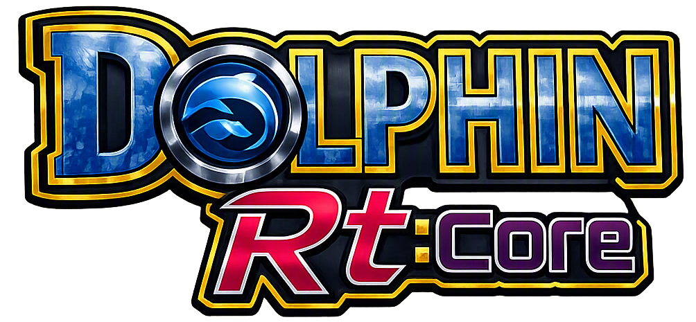

# DOLPHIN Rt:CORE

### H700 FIELD ENGINEERING // GAMECUBE + WII

**One engine. Multiple firmware layers. No fake benchmarks. No plug-and-play promises.**

**SPDW FACTORY LAB // SILVERCROW2323**

---

> **FIELD NOTE // 2026-11-11**
>
> The active hardware reference for this development line is the **Anbernic RG35XX H with the Allwinner H700 SoC**.
> Legacy hardware notes have been reconciled with this RG35XX H reference.
>
> A successful build is not a successful device boot. The current H700 binaries still need to pass the on-device launch, font, input, rendering and clean-exit checks described below.

## 01 — The project

Dolphin Rt:Core is a community engineering stack for running and integrating **Dolphin GameCube/Wii emulation** on constrained ARM64 handhelds.

It combines a pinned Dolphin source build, handheld-specific runtime glue, the Rt:UI frontend, profile/configuration tooling, a compatibility database and a separate PC-side streaming portal.

The primary device in this workstream is the **RG35XX H / H700**. Other H700 handhelds may share the same broad CPU architecture, but different screens, controls, firmware images, drivers and memory layouts still require their own validation.

This project does not promise that every GameCube or Wii title will run at full speed. Performance depends on the game, region, emulator revision, firmware, graphics path and selected profile. The compatibility database is a collection of reports, not a universal guarantee.

## 02 — Platform matrix

| Platform | Integration | Current status |
|---|---|---|
| **muOS 2606.0 Andromeda** | Main v12.0.0 Kanzentai package, Rt:UI, RtSys and core registration | Primary handheld line. The reproducible H700 NoGUI build is in the native ARM64 workflow; fresh binaries still require an RG35XX H runtime test. |
| **muOS 2601.1 Jacaranda** | Legacy v11.5.1 Triptych line | Historical/legacy release line. Do not install the Andromeda package on Jacaranda by assumption. |
| **Knulli / Batocera** | Separate Rt:Core K integration | Existing RG35XX H / Knulli Scarab device testing is documented in the K port. Verify each new binary/resource pair before releasing it. |
| **ROCKNIX** | Separate Rt:Core R integration with a Wayland-enabled build target | Experimental. The old fbdev binary/display mismatch is the reason for the dedicated Wayland build. A successful CI build still needs a physical-device launch test. |
| **Linux desktop x86_64** | Qt GUI + NoGUI bundle with X11/Wayland and local Sys resources | Dedicated PC build intended for MX Linux XFCE and comparable Debian/Ubuntu desktops; separate from handheld binaries. |
| **ARM64 desktop** | Qt GUI and NoGUI build variants | Build and diagnostic target; not a handheld firmware package. |

> [!WARNING]
> **Build status is not hardware status.** CI, Xvfb, patch checks, package dry-runs and ELF inspection cannot certify a real RG35XX H boot. Do not describe a target as device-tested until the exact firmware, binary and package have been exercised on hardware.

## 03 — The H700 reality check

The RG35XX H uses the Allwinner H700 platform. The project's optimisation work is constrained by the actual device, not by desktop-class assumptions.

| Component | Practical implication |
|---|---|
| CPU | Quad-core Cortex-A53 AArch64. Dolphin's JIT path and the workload of each title dominate performance. |
| GPU | Mali-G31 MP2. The graphics backend, shader workload, memory bandwidth and driver matter. |
| Memory | 1 GB shared system memory on the RG35XX H. Large texture packs and unnecessary background services can cause memory pressure. |
| Display | 640×480 panel. Native internal resolution is the baseline; higher resolution is a significant extra workload. |
| Storage | microSD. Keep game images, shader caches and user data organised; storage speed does not compensate for CPU/GPU limits. |

No universal FPS promise is made here. Use the compatibility database and record the exact Game ID, region, profile, firmware and device when testing.

## 04 — What ships in the Kanzentai stack

The current muOS line combines the formerly separate flavours into one installation.

| Layer | Component | Role |
|---|---|---|
| I | **Dolphin engine** | Pinned emulator build, profiles, GameSettings and system resources. |
| II | **RtSys** | Device baseline, launch integration, profile application, muOS core registration and low-level diagnostics. |
| III | **Rt:UI / FrontendONE** | LÖVE-based library, configuration, compatibility, tools and user interface. |
| IV | **Rt:Stream** | PC-side streaming workflow and handheld Moonlight companion; streaming is not local H700 emulation. |

The active muOS frontend lives in **dolphin-rtcore-muos/app/Dolphin RtUI/**. Historical material in **Core_History/** is an archive and is not automatically the current implementation.

### Rt:UI system status and Dolphin's native resources

Press **M** in Rt:UI to expand the header into the scrollable **Rt:System Status Center**. It reports Wi-Fi and battery telemetry, Rt:Stream portal/Sunshine health, database download state, GameSettings deployment, library indexing, background operations and notification history. Wi-Fi link state and remote server health are deliberately reported separately.

Keep Dolphin's official **Sys/GameSettings/** and **Sys/Load/GraphicMods/** resources. Rt:UI's **Mod Vault → Graphics Mods** combines that built-in catalog with user mods from **Load/GraphicMods/**. A mod marked **All Games** is eligible for every game; it is not globally enabled. Enablement is saved per Game ID in the game's **Config/GraphicMods** profile, and the launcher turns on Dolphin's Graphics Mods engine only when that profile contains an enabled entry. See [Graphics Mods](wiki/Graphics-Mods.md) and [Rt:System Status Center](wiki/Rt-System-Status-Center.md).

## 05 — Build system

The reproducible build scripts live in [dolphin-build/](dolphin-build/README.md). The upstream Dolphin revision is pinned in [DOLPHIN_REF](dolphin-build/DOLPHIN_REF); builds do not silently float to upstream HEAD.

| Build target | Frontend | Runtime/display model |
|---|---|---|
| **muos** | NoGUI | FBDev + SDL/EGL/GLES; intended for the muOS H700 launcher. |
| **muos-qt** | NoGUI + Qt GUI | Experimental Qt/EGLFS test bundle; not the default launcher. |
| **knulli** | NoGUI | FBDev + SDL/EGL/GLES; Knulli-specific packaging. |
| **rocknix** | NoGUI | Wayland + SDL/EGL/GLES with the ROCKNIX patch series. |
| **desktop** | NoGUI + Qt GUI | Linux x86_64 PC (MX XFCE) and ARM64 Linux desktop. |

The embedded targets use Dolphin's **NoGUI frontend**. NoGUI does not mean that games render headlessly: it means Dolphin does not create its own desktop management window. The game is rendered through the selected platform/backend and launched by the firmware integration.

### Build on Linux desktop or native AArch64 host

~~~bash
# muOS / RG35XX H
./dolphin-build/build-dolphin.sh --target muos --frontend nogui --out ./out/muos

# Knulli / RG35XX H
./dolphin-build/build-dolphin.sh --target knulli --frontend nogui --out ./out/knulli

# ROCKNIX / H700 — verify patches before compiling
./dolphin-build/verify-patches.sh
./dolphin-build/build-dolphin.sh --target rocknix --frontend nogui --out ./out/rocknix

# Experimental muOS Qt bundle — compile test only
./dolphin-build/build-dolphin.sh --target muos-qt --frontend both --out ./out/muos-qt

# Linux desktop (x86_64 MX XFCE or ARM64) — both frontends
./dolphin-build/build-dolphin.sh --target desktop --frontend both --tune none --out ./out/desktop
~~~

The build script supports **--ref SHA**, **--jobs N**, **--no-lto**, **--tune cortex-a53|none**, **--deps** and **--no-deps**. Handheld H700 builds use **-mtune=cortex-a53** without enabling extra CPU instructions; desktop builds default to neutral tuning and reject the Cortex-A53 option.

### Build validation

Before an artifact can be uploaded, the native ARM64 workflow checks the executable and relevant runtime payloads as **ELF64/AArch64**, verifies required Dolphin **Sys/** resources and preserves the matching GPL source archive. The validator is shared with an independent regression test:

~~~bash
bash dolphin-build/validate-aarch64-elf.sh ./out/muos/dolphin
bash tests/test_aarch64_elf_validator.sh
~~~

The test rejects wrong ELF class/architecture, malformed headers, unreadable or missing files, empty files and missing **readelf**.

### muOS package assembly

Use the binary and **Sys/** directory from the **same build output**:

~~~bash
DOLPHIN_BIN="$PWD/out/muos/dolphin" DOLPHIN_SYS_DIR="$PWD/out/muos/Sys" DOLPHIN_LIB_DIR="$PWD/out/muos/lib" bash dolphin-rtcore-muos/tools/build-muxupd.sh ./dist
~~~

The separate Qt 6 experiment is packaged by **build-muxupd-qt6-experimental.sh**; it installs alongside the stable NoGUI executable and must never silently replace it.

### Knulli and ROCKNIX package assembly

~~~bash
./tools/make-port-release.sh k --binary "$PWD/out/knulli/dolphin" --sys-dir "$PWD/out/knulli/Sys"
./tools/make-port-release.sh r --binary "$PWD/out/rocknix/dolphin" --sys-dir "$PWD/out/rocknix/Sys"
~~~

Never mix an executable and **Sys/** tree from different Dolphin revisions.

## 06 — Linux desktop / MX XFCE

The dedicated x86_64 artifact includes dolphin-gui, dolphin (NoGUI), the matching Sys resource tree, launch helpers, build information and the corresponding GPL source archive. It is built against the Ubuntu 22.04 / glibc 2.35 baseline with GCC 12 and expects Qt 6 plus the runtime libraries listed in README-MX-XFCE.md.

Extract the Dolphin-RtCore-Desktop-x86_64-*.tar.gz bundle, install the listed MX packages, and run ./run-gui.sh. To add the launcher to the XFCE application menu, run ./install-desktop-entry.sh. The bundle is x86_64-only and must not be copied to the H700 handheld.

## 07 — Install on muOS Andromeda

1. Back up the SD card, saves and existing Dolphin configuration.
2. Download the matching Andromeda **.muxupd** from [Releases](https://github.com/SilverCrow2323/dolphin-rt-core/releases).
3. Copy it to the SD card's **ARCHIVE** folder.
4. Install it with muOS **Archive Manager**.
5. Ensure the AArch64 Dolphin executable is installed at **/opt/muos/share/emulator/dolphin/dolphin**.
6. Launch **Dolphin Rt:Core** from Applications.
7. In Content Explorer, select a GameCube or Wii ROM folder, open **Core Assignment**, and choose a profile.

The Andromeda package includes the integrity manifest required by that release line. The registration helper detects the installed muOS registration layout and maintains the GameCube/Wii entries. For registration details and recovery commands, see [docs/MUOS_REGISTRATION.md](docs/MUOS_REGISTRATION.md).

> [!IMPORTANT]
> Jacaranda is a separate legacy release line. Registration detection does not make the current Andromeda package a certified Jacaranda package.

## 08 — RG35XX H validation checklist

A build is not marked **H700 device-tested** until the following checks have been performed on the actual RG35XX H and the exact target firmware:

- [ ] Confirm **uname -m** reports **aarch64** and capture the muOS version.
- [ ] Confirm the installed Dolphin executable is ELF64/AArch64.
- [ ] Confirm the launcher resolves its private libraries and the matching **Sys/** resource tree.
- [ ] Confirm GameCube Western/Japanese fonts and DSP resources are present.
- [ ] Confirm controller input, hotkeys and the return-to-frontend path.
- [ ] Launch a known lightweight GameCube title.
- [ ] Launch a known lightweight Wii title.
- [ ] Check video output, audio, frame pacing and memory pressure.
- [ ] Exit cleanly and inspect the Dolphin/RtSys logs.
- [ ] Record the exact game ID, region, profile, firmware, build SHA and observed result.

Do not upload private logs, pairing tokens, ROMs or BIOS files to issue reports. Redact serials, MAC addresses and other device identifiers.

## 09 — Repository map

| Path | Purpose |
|---|---|
| [dolphin-rtcore-muos/](dolphin-rtcore-muos/) | Current muOS application, emulator data, overlay, installer and package tools. |
| [dolphin-build/](dolphin-build/) | Pinned Dolphin source build, platform patches, ELF validation and ARM64 workflow. |
| [dolphin-rtcore-k/](dolphin-rtcore-k/) | Knulli / Batocera integration. |
| [dolphin-rtcore-r/](dolphin-rtcore-r/) | Experimental ROCKNIX integration. |
| [portal/](portal/) | PC-side Rt:Stream portal and desktop packaging. |
| [data/](data/) | Compatibility and configuration databases. |
| [assets/](assets/) | Repository artwork and shared visual assets. |
| [docs/](docs/) | Engineering, registration, release and troubleshooting documentation. |
| [wiki/](wiki/) | Tracked Markdown source for the GitHub Wiki. |
| [Core_History/](Core_History/) | Historical implementations and provenance archive. |

## 10 — CI, releases and contribution

GitHub Actions runs repository contracts, packaging dry-runs, frontend smoke tests and native ARM64 build variants. Successful build jobs upload the binary, build information, checksums and corresponding source archive. An artifact is only available after its job completes successfully.

Development should happen on short-lived branches and be merged through pull requests. Keep changes small and independently reviewable. Do not bypass a failing check by weakening architecture validation or relabelling an untested build.

**Current engineering priorities**

1. Produce a repeatable muOS NoGUI ARM64 artifact for the H700.
2. Validate the artifact on the RG35XX H: fonts, HIDAPI, input, rendering and safe exit.
3. Deliver a reproducible x86_64 desktop bundle for MX XFCE and verify it on a real PC.
4. Keep the Qt 6 EGLFS path experimental until it boots and renders on device.
5. Finish the ROCKNIX Wayland build and hardware validation.
6. Keep compatibility reports, wiki pages and release notes aligned with actual test evidence.

## 11 — Documentation and links

- [Releases](https://github.com/SilverCrow2323/dolphin-rt-core/releases)
- [Issues](https://github.com/SilverCrow2323/dolphin-rt-core/issues)
- [Compatibility Database](https://silvercrow2323.github.io/dolphin-rt-core/)
- [Engineering guide](docs/REPO_GUIDE.md)
- [Build guide](dolphin-build/README.md)
- [muOS registration](docs/MUOS_REGISTRATION.md)
- [Troubleshooting](docs/TROUBLESHOOTING.md)
- [Project Wiki](wiki/Home.md)
- [Dolphin upstream](https://dolphin-emu.org/)
- [muOS](https://muos.dev/)

---

**DOLPHIN Rt:CORE // SPDW FACTORY**

*H700 FIELD UNIT — RG35XX H*

**BUILD IT. INSPECT IT. BOOT IT. THEN CALL IT DONE.**

## 📚 Practical Wiki

The tracked [Wiki source](wiki/) provides short task guides for installation, controller profiles, compatibility reports and troubleshooting. One page covers one topic; required information is labelled **MUST KNOW!!**, non-essential enhancements are **Optional**, and basic steps stay unlabelled. Publish with `bash tools/publish-wiki.sh`.
