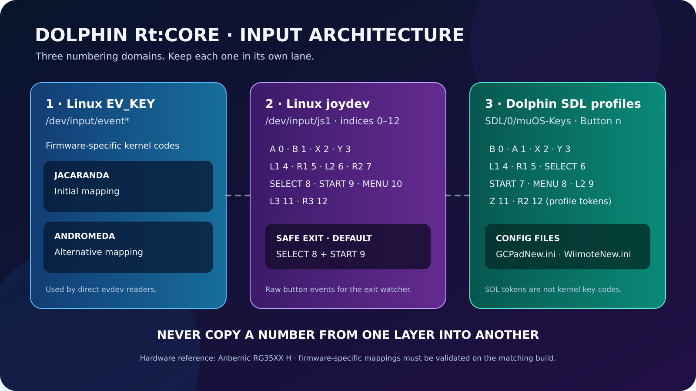
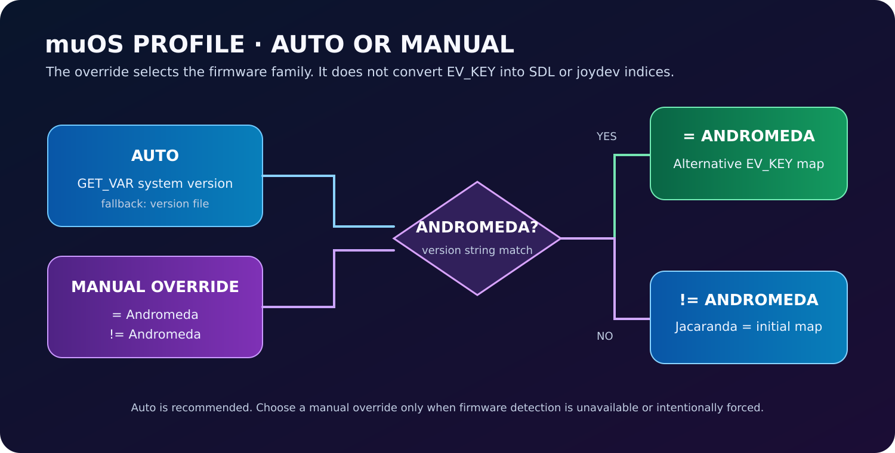

# Controller input reference

> [!IMPORTANT]
> **Do not mix Linux `EV_KEY` codes, joydev button indices, and Dolphin SDL `Button n` tokens.** They belong to different interfaces and can have different numbers for the same physical control.

## 1. Firmware-specific Linux EV_KEY codes

These values identify key events exposed by Linux input devices (normally `/dev/input/event*`). The RG35XX H diagnostics recorded two firmware layouts:

### muOS Jacaranda — initial mapping

| Control | EV_KEY code |
|---|---:|
| A | 304 |
| B | 305 |
| X | 307 |
| Y | 308 |
| L1 | 310 |
| R1 | 311 |
| SELECT | 312 |
| L3 | 313 |
| R3 | 314 |
| MENU | 315 |
| START | 316 |
| L2 | 317 |
| R2 | 318 |
| Volume − | 114 |
| Volume + | 115 |

### muOS Andromeda — alternative mapping

| Control | EV_KEY code |
|---|---:|
| A | 304 |
| B | 305 |
| Y | 306 |
| X | 307 |
| L1 | 310 |
| R1 | 311 |
| L2 | 312 |
| R2 | 313 |
| SELECT | 314 |
| START | 315 |
| MENU / MODE | 316 |

The Andromeda layout moves the face-button and lower controls compared with Jacaranda. Do not apply the Andromeda table to Jacaranda.

## 2. Linux joydev indices

The RTUI Safe Exit watcher reads a joydev device such as `/dev/input/js1`. The RG35XX H sequence recorded during device diagnostics is:

| Control | joydev button index |
|---|---:|
| A | 0 |
| B | 1 |
| X | 2 |
| Y | 3 |
| L1 | 4 |
| R1 | 5 |
| L2 | 6 |
| R2 | 7 |
| SELECT | 8 |
| START | 9 |
| MENU / M | 10 |
| L3 | 11 |
| R3 | 12 |

This is a zero-based joydev button index table, **not** an EV_KEY table and **not** Dolphin's SDL `Button n` configuration. Confirm the node and sequence on the target device before changing the default.

### Safe Exit defaults

- Default combination: **START + SELECT** → joydev indices **9 + 8**.
- Single-button custom exit: **MENU / M** → index **10**.
- The raw watcher reads the saved indices from `data/safe_exit.conf`.
- The RTUI launcher and Content Explorer launcher prefer `/dev/input/js1`, then `js0`, then another available `js*` character device. A phantom or non-character `js0` node is ignored.

See [Hotkeys and Safe Exit](HOTKEYS.md).

## 3. Dolphin SDL controller-profile tokens

The bundled Dolphin profiles use an SDL device named `SDL/0/muOS-Keys` and zero-based tokens such as `Button 0`. The current default profiles define these assignments:

| Dolphin input | GameCube profile | Wii profile |
|---|---|---|
| A | Button 1 | Button 1 |
| B | Button 0 | Button 0 |
| X | Button 2 | — |
| Y | Button 3 | — |
| Z (L3 hardware button) | Button 11 | — |
| START / + | Button 7 | Button 7 |
| L / Nunchuk C | Button 4 | Button 4 |
| L-Analog / Nunchuk Z | Button 9 | Button 5 |
| R | Button 5 | — |
| Volume + | Button 10 (system key) | — |
| R-Analog | Button 12 | — |
| 1 / 2 | — | Button 2 / Button 3 |
| − / HOME | — | Button 6 / Button 8 |

RtUI raw-button defaults use the same SDL numeric IDs, including L3 = Button 11; standardized SDL gamepad events use named buttons. These assignments are sourced from the checked-in `GCPadNew.ini`, `WiimoteNew.ini`, `docs/CONTROLLER.md`, and controller-map editor. They are Dolphin's SDL-profile tokens; they must not be overwritten with values copied from the EV_KEY or joydev tables.

## 4. muOS firmware selector

The RTUI System settings store `muos_profile`:

| Selector value | Meaning |
|---|---|
| `auto` | Read the installed version and resolve automatically. |
| `andromeda` | Force the Andromeda profile (`= Andromeda`). |
| `not_andromeda` | Force the non-Andromeda profile (`!= Andromeda`); Jacaranda belongs here. |

Automatic detection reads `MUOS_VERSION` when exported, otherwise tries `GET_VAR system version`, then `/opt/muos/config/system/version`. A version string containing `andromeda` resolves to Andromeda; other versions resolve to non-Andromeda.

> [!NOTE]
> The firmware selector is a release-family override. RtUI receives controller input through LÖVE/SDL, while the Safe Exit watcher consumes joydev events. Dolphin's GameCube/Wii profiles use their own SDL `Button n` tokens. Changing an EV_KEY number does not change an SDL profile token.

## 5. Validation on the RG35XX H

Before reporting an input regression, capture the firmware identity and each layer separately:

1. Record the exact muOS version (Jacaranda or Andromeda).
2. Inspect `/proc/bus/input/devices` and identify the controller event device.
3. Inspect `/dev/input/js*` and verify which nodes are character devices.
4. Use a joydev test tool, when available, to confirm button indices from 0 through 12.
5. Check the bundled Dolphin `GCPadNew.ini` / `WiimoteNew.ini` separately from the kernel event table.
6. Record the firmware, device, input node, observed values and Rt:Core commit in the bug report.

Do not publish ROMs, BIOS files, serials, MAC addresses, pairing tokens or unredacted private logs.
