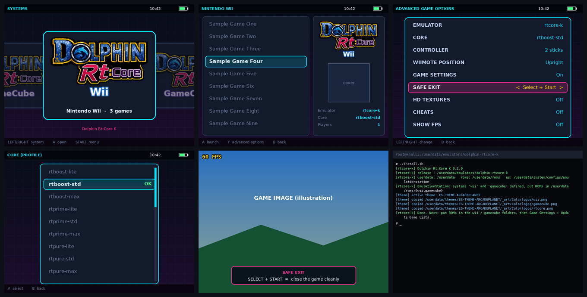

# Dolphin Rt:Core K

The **Dolphin Rt:Core** build (11.5.00 "Triptych") ported from muOS to **Knulli / Batocera**, with per-game profiles and options selectable straight from EmulationStation.

- Target: Anbernic RG35XX-H (H700, aarch64), tested on Knulli `scarab 2026/05/11`. Other devices: see [Adding a device](#adding-a-device).
- No ROMs, no BIOS and no Nintendo files are included.



*Illustrative renders of the menus (640x480, generated by `docs/make_screens.py`), not photos of the device.*

## Install

The folder can live **anywhere** (`/userdata/emulators/`, `/userdata/tools/`, ...). No path is written in the scripts: everything is resolved from where the folder is.

### Option A - ready-to-go archive (offline)
```
mkdir -p /userdata/emulators
tar -xzf Dolphin-RtCore-K_v0.2.0_emulators.tar.gz -C /userdata/emulators
/userdata/emulators/dolphin-rtcore-k.sh            # registers everything in EmulationStation
```
From a PC, if the device has no `unzip`: `tar -xzf` the archive locally and copy with `ssh`/`scp`, or use the `.zip` and extract it with any tool.

### Option B - online installer (downloads everything from the repo)
```
curl -fsSL https://raw.githubusercontent.com/SilverCrow2323/dolphin-rt-core/main/knulli/get.sh | bash
```
It downloads the release into `/userdata/emulators/dolphin-rtcore-k` and runs the installer. Run it again later and it **updates** instead (your saves and settings are kept).
Options: `--dest DIR`, `--repo OWNER/NAME`, `--ref BRANCH_OR_TAG`, `--subdir DIR`, `--url TARBALL_URL`.
The default repo/branch/folder live in `config/repo.conf`.

### Option C - from a git checkout
```
git clone https://github.com/SilverCrow2323/dolphin-rt-core && cd dolphin-rt-core/knulli && ./install.sh
```

### After installing
1. Put your ROMs in `roms/wii` and `roms/gamecube`.
2. EmulationStation: *Game Settings -> Update Game Lists*.

> Do **not** put the folder inside `roms/ports`: EmulationStation would list its `.sh` files as games. If you really want to, start the folder name with a dot (e.g. `.DolphinRtCoreK`), which EmulationStation should ignore.

### The `rtcore.sh` helper
```
./rtcore.sh install | update | uninstall | status
./rtcore.sh run "/userdata/roms/wii/Game.rvz" rtboost-std      # start a game directly
```
`install.sh` options: `--update --offline --userdata DIR --roms DIR --es-dir DIR --themes DIR --no-es --no-theme --no-restart --dry-run`.

## Use

EmulationStation -> **Wii** or **GameCube** -> pick a game -> advanced game options:

| Option | Values |
|---|---|
| **Emulator / Core** | the Rt:Core profile: `default`, `rtboost-*`, `rtprime-*`, `rtpure-*` (tiers `lite` / `std` / `max`), `sweetspot`, `performance`, `compatibility`, `speedhacks`, `blackscreenfix`, `rintromping`, `rtverbose` |
| **CONTROLLER** | 2 sticks / 1 stick / no sticks |
| **WIIMOTE POSITION** | upright / sideways (Wii only) |
| **GAME SETTINGS** | on / off - per-game `.ini` fixes |
| **SAFE EXIT** | Select + Start (default) or Menu + Start |
| **HD TEXTURES** | off / on (`core/Load/Textures`) |
| **CHEATS** | off / on |
| **SHOW FPS** | off / on |

Options can be set per game, per system or globally (EmulationStation stores them in `batocera.conf`).
**Leaving a game:** press Select + Start. Dolphin gets `EXIT_GRACE` seconds (default 8) to close cleanly before it is killed.

## Where your data lives

Everything is inside the release folder, so a backup is just a copy of it:
`core/Gamecube/` memory cards, `core/Wii/` NAND, `core/StateSaves/` save states, `logs/launch.log` launcher log.
The original muOS paths (`/run/muos/...`) found in the profiles are rewritten at every launch.

## Adding a device

Copy `config/devices/rg35xx-h.conf` to `config/devices/<name>.conf`, then adjust `PAD_NAME` (see `sdl2-jstest --list`), `SDL_GUID`, `SDL_MAP`, `NUMSTICKS` and the button numbers, and set `DEVICE=<name>` in `config/rtcore.conf` (or `RTCORE_DEVICE=<name>`).
Do not edit `rg35xx-h.conf` in place if you want to keep changes across updates - updates overwrite the shipped device files.

## Updating

`./rtcore.sh update` (or run `get.sh` again). Never touched by an update: memory cards, Wii NAND, save states, logs, `config/rtcore.conf`, `config/repo.conf` and the active `Config/*.ini` files.

## Troubleshooting

| Problem | What to do |
|---|---|
| Systems do not show up | restart EmulationStation (`/etc/init.d/S31emulationstation restart`), then update the game lists |
| Text instead of a logo | the active theme has a different layout than ARCADEPLANET (`_art/Colorlogos`); the logos are in `theme/logos/` |
| Buttons or sticks do not respond | check `PAD_NAME` / `SDL_GUID` in the device file and `logs/launch.log` |
| Black screen | try the `blackscreenfix` profile |
| Want to see what would run | `RTCORE_DRYRUN=1 bin/rtcore-k.sh <ROM> <profile>` prints the command without starting Dolphin |

## Layout

```
bin/rtcore-k.sh        launcher (ROM + profile)
config/                rtcore.conf, repo.conf, cores.list, devices/
core/                  dolphin binary + Sys, Config, RtSys/factory, Load, Wii, GC
es/                    EmulationStation templates (rendered by install.sh)
theme/                 logos + install-theme.sh
docs/                  screenshot generator + screens
install.sh uninstall.sh rtcore.sh get.sh
tools/make-release.sh  builds the release archives
ui/                    frontend (planned)
legacy-muos/           original muOS launcher, tasks and LOVE UI, kept as reference for the port
```

Publishing it as a git repo: `git init && git add . && git commit` (see `.gitignore`). To build the archives: `tools/make-release.sh`.

## Known limits
The frontend UI is not ported yet - graphic mods and hotkeys per game are still to do - logos were only checked against the ARCADEPLANET layout. See `NOTICE.md` for licences.
