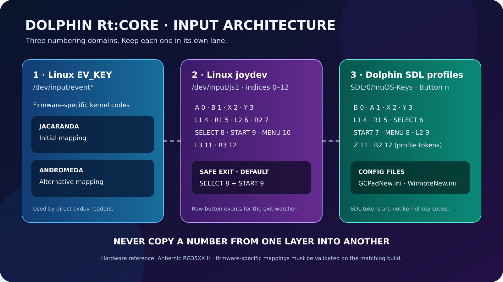

# 🎮 Controller Input · Dolphin Rt:Core

**One physical controller · three different numbering layers**

> [!WARNING]
> Never copy a number from the Linux EV_KEY table into a Dolphin `Button n` profile. Joydev and SDL indices are separate too.

## Firmware EV_KEY maps

### 🟣 Jacaranda · initial mapping

| Button | EV_KEY |
|---|---:|
| A / B | 304 / 305 |
| X / Y | 307 / 308 |
| L1 / R1 | 310 / 311 |
| SELECT / L3 / R3 | 312 / 313 / 314 |
| MENU / START | 315 / 316 |
| L2 / R2 | 317 / 318 |
| Volume − / + | 114 / 115 |

### 🔵 Andromeda · alternative mapping

| Button | EV_KEY |
|---|---:|
| A / B | 304 / 305 |
| Y / X | 306 / 307 |
| L1 / R1 | 310 / 311 |
| L2 / R2 | 312 / 313 |
| SELECT / START | 314 / 315 |
| MENU / MODE | 316 |

## joydev · `/dev/input/js1`

| Button | Index | Button | Index |
|---|---:|---|---:|
| A | 0 | B | 1 |
| X | 2 | Y | 3 |
| L1 | 4 | R1 | 5 |
| L2 | 6 | R2 | 7 |
| SELECT | 8 | START | 9 |
| MENU / M | 10 | L3 | 11 |
| R3 | 12 |  |  |

This is the joydev sequence recorded for the RG35XX H. Verify the actual character device before debugging the watcher; some builds may expose a phantom `js0`.

## Safe Exit

<badge>Default: START + SELECT</badge>

- START = joydev index **9**.
- SELECT = joydev index **8**.
- A single-button custom exit is allowed for MENU / M (index **10**).
- RTUI and Content Explorer use the same `data/safe_exit.conf` contract.

## Dolphin SDL profile tokens

The current `GCPadNew.ini` and `WiimoteNew.ini` profiles use zero-based SDL tokens such as `Button 0` and `Button 1`. For example:

| Physical label in profile | Dolphin token |
|---|---:|
| B | Button 0 |
| A | Button 1 |
| X / Y | Button 2 / Button 3 |
| L1 / R1 | Button 4 / Button 5 |
| START | Button 7 |
| L2 analogue / R2 analogue | Button 9 / Button 12 |

The Wii profile also maps 1/2, +/−, HOME and Nunchuk controls. Consult the shipped INI files rather than assuming that the GameCube table applies unchanged.

<strong>More detail: diagnosis checklist</strong>

1. Record the installed muOS release.
2. Identify the controller in `/proc/bus/input/devices`.
3. Verify which `/dev/input/js*` nodes are character devices.
4. Inspect the joydev sequence independently from EV_KEY.
5. Inspect Dolphin's SDL profile independently from both Linux tables.
6. Include the firmware and Rt:Core commit in the report.

Do not attach ROMs, BIOS files, serials, MAC addresses or private tokens to a public issue.

**Technical reference:** [docs/CONTROLLER_INPUT.md](https://github.com/SilverCrow2323/dolphin-rt-core/blob/main/docs/CONTROLLER_INPUT.md) · [Hotkeys and Safe Exit](https://github.com/SilverCrow2323/dolphin-rt-core/blob/main/docs/HOTKEYS.md)
