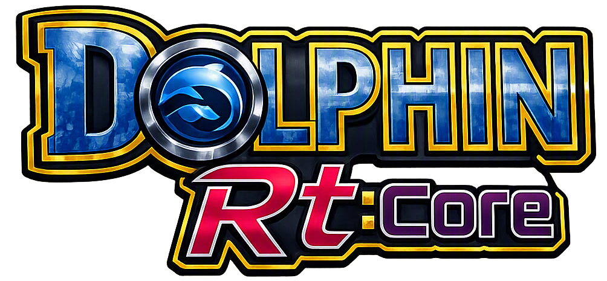

# Dolphin Rt:Core · Project Wiki

**The practical handbook for the handheld core, frontend, compatibility database and Rt:Stream.**

[Repository](https://github.com/SilverCrow2323/dolphin-rt-core) · [Releases](https://github.com/SilverCrow2323/dolphin-rt-core/releases) · [Issues](https://github.com/SilverCrow2323/dolphin-rt-core/issues) · [Compatibility site source](https://github.com/SilverCrow2323/dolphin-rt-core/blob/main/index.html)

---

> [!IMPORTANT]
> Compatibility results are community reports, not universal guarantees. Always match the exact console, game region, handheld, firmware, Rt:Core build and profile before applying settings.

## Choose your path

| I want to… | Start here |
|---|---|
| Install or upgrade on muOS | [[Quick-Start]] · [[muOS-Registration]] |
| Understand controls and profile families | [[Controls-and-Profiles]] |
| Find a GameCube/Wii result | [[Compatibility-Database]] |
| Understand ratings and FPS | [[Rating-Guide]] |
| Submit a reproducible test | [[Reporting-a-Test]] |
| Understand report fields | [[Compatibility-Data-Model]] |
| Maintain the compatibility site | [[Compatibility-Site]] |
| Fix a missing core or frontend issue | [[Troubleshooting]] · [[FAQ]] |
| Build, test or contribute | [[Development]] · [[Architecture]] · [[Contributing]] |
| Write or review a practical Wiki page | [[Conventions-and-Template]] |
| Work on PC streaming | [[Rt-Stream]] |
| Prepare a release | [[Quality-Gates]] · [[Release-Checklist]] |

## Project at a glance

- **muOS** — primary handheld release line with version-aware core registration.
- **Knulli** — separate platform integration and packaging.
- **ROCKNIX** — experimental port; consult the root README before use.
- **Dolphin RtUI** — LÖVE frontend for library, profiles, compatibility, diagnostics and Rt:Stream.
- **Compatibility Database** — static web application backed by the tracked test-report JSON.
- **Rt:Stream** — PC-side portal and handheld Moonlight client.

See [[Project-Map]] and [[Platform-Support]] for boundaries and supported combinations.

## Compatibility Database

The source web application is the repository-root `index.html`; its data comes from the frontend's tracked `games_data.json` and `gamesettings.json`. The app includes GameCube/Wii themes, search, region/boot/rating filters, per-device and per-muOS filters, shareable filter URLs, report submission and offline shell support.

**The source file is not proof that GitHub Pages is enabled.** Use a public Pages URL only after the repository owner has configured Pages. See [[Compatibility-Site]].

## Documentation rules

1. The root README and current release notes are authoritative for versions and support status.
2. This Wiki explains procedures; it must not silently broaden the supported-device matrix.
3. Mark hardware tests as hardware tests. CI, Xvfb, emulation and syntax checks are not handheld certification.
4. Never upload ROMs, BIOS, private logs, pairing tokens or device identifiers.

## Maintainer entry points

- [Engineering guide](https://github.com/SilverCrow2323/dolphin-rt-core/blob/main/docs/REPO_GUIDE.md)
- [Compatibility website guide](https://github.com/SilverCrow2323/dolphin-rt-core/blob/main/docs/COMPATIBILITY_SITE.md)
- [Tracked Wiki Markdown](https://github.com/SilverCrow2323/dolphin-rt-core/tree/main/wiki)
- [Screenshot helper](https://github.com/SilverCrow2323/dolphin-rt-core/blob/main/tools/capture-ui.sh)
- [Asset inventory](https://github.com/SilverCrow2323/dolphin-rt-core/blob/main/tools/asset_inventory.py)
