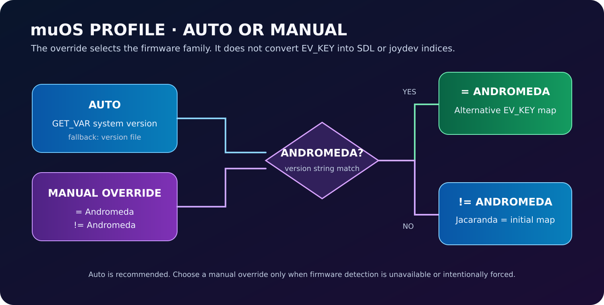

# ⚙️ muOS Firmware Profiles

**Automatic detection, explicit override, correct controller family**

## The rule

- **Jacaranda** uses the **initial** RG35XX H EV_KEY mapping.
- **Andromeda** uses the **alternative** EV_KEY mapping.
- Jacaranda belongs to the **non-Andromeda** branch (`!= Andromeda`).

## Selector

| Setting | Behaviour |
|---|---|
| **Auto** | Detect the installed firmware version. Recommended. |
| **= Andromeda** | Force the Andromeda profile. |
| **!= Andromeda** | Force the non-Andromeda profile; use this for Jacaranda. |

The setting key is `muos_profile` and the persisted values are `auto`, `andromeda`, and `not_andromeda`.

## How Auto resolves the release

The launcher exports `MUOS_VERSION`. The RTUI detector checks:

1. `MUOS_VERSION`, when already available.
2. muOS `GET_VAR system version`.
3. `/opt/muos/config/system/version` as a file fallback.

A case-insensitive version string containing `andromeda` resolves to Andromeda. Other detected versions resolve to non-Andromeda.

<strong>When should I override Auto?</strong>

Only when the firmware version cannot be read or when testing a specific family intentionally. A manual override is useful for diagnostics, but it does not turn an Andromeda package into a Jacaranda-certified release.

Do not force the setting merely to fix an unrelated SDL profile. Kernel EV_KEY, joydev `js1`, and Dolphin SDL `Button n` values are separate layers.

## Validation and release safety

- Match the package to the target firmware's installation and registration format.
- Check the version string and detected profile in the logs.
- Test controller buttons, Safe Exit, launcher return path, and core registration on actual hardware.
- CI success proves syntax/build/package integrity only; it is not hardware certification.

**Related:** [[Controller-Input]] · [[Quick-Start]] · [[Troubleshooting]] · [Controller reference](https://github.com/SilverCrow2323/dolphin-rt-core/blob/main/docs/CONTROLLER_INPUT.md)
